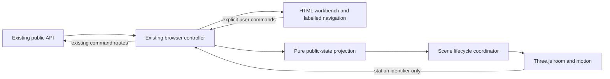

# Architecture: Shiftwork 3D workplace

Gate 2 APPROVED, 2026-10-19, Asia/Singapore.

The user said "Sure i approve" after the architecture was presented and requested
a handoff. This selects the architecture below, not an exact Three.js release,
dependency acquisition, implementation, publication or deployment.

Prerequisite: [Gate 1](01-product.md) is approved. S28 remains accepted. This
proposal extends presentation for the existing three boards. It does not replace
the controller or change the learning loop.

## 1. Decision

Add a self-hosted **Three.js WebGL 2 scene** to the existing plain-JavaScript
client, beside the existing HTML workbench. Keep the single FastAPI process,
SQLite store, public projections and command routes. The scene is a view of the
work, not an execution engine, evaluator or second application controller.

Use original low-poly geometry, shared materials, a stable three-quarter camera
and short state-driven transitions. Start with a complete Bellwether journey,
then provide distinct Stonebridge and Northline room definitions through the same
presentation boundary. Layout A is the default. Essential labels and actions
remain HTML controls, including an expanded workbench for sustained editing.

### Alternatives considered

- **SVG or CSS only:** retain as an unavailable-scene fallback. It does not meet
  the approved destination of a real 3D workplace.
- **React Three Fiber and a React client migration:** adds a framework transition
  to a working vanilla-JavaScript client. The room does not require that change.
- **A game engine or a new WebGPU renderer:** adds runtime and delivery complexity
  without a product need for physics, free roaming or advanced graphics.
- **A bundled Three.js application:** viable if the eventual dependency graph
  requires it, but not the proposed baseline. Begin with locally served ES modules
  and core primitives, without loaders, post-processing or control addons.

Three.js documents browser ES modules without a compilation step. Self-hosting
that module graph is our delivery choice, rather than a claim that its guide
recommends this for every project. Exact release, imported files and hashes are
fixed at Gate 3 before acquisition. See [official installation guidance][install].

## 2. Fit with the current source

Current source was inspected at `1a943d9` with the inherited Gate 1 documentation
changes preserved. These are source observations, not fresh runtime proofs.

- `shiftwork/app.py:68` serves the client through FastAPI StaticFiles after the
  existing API routes. No additional web service is needed.
- `shiftwork/client/app.js:4` owns browser state. Its API helper is at line 24.
  `refresh()` at line 273 joins the board, run, investigation, ledger, output,
  check and selected-version projections, with generation checks before commit.
- `app.js:319` polls a nonterminal selected run every second. Comparison and
  diagnostic handlers already poll their own returned experiment identifiers.
  The renderer must not add another network loop.
- `activateStation()` at `app.js:1180` owns station mapping, visible panels,
  journey state and URL synchronization. Narrow-screen focus and scroll handling
  starts at line 1169. Reuse these paths for a 3D object pick.
- `shiftwork/client/evidence.js:1` joins an output to checks and ledger derivations
  through public run, output, ordinal and check-result identities. Reuse that
  linkage rather than inventing a second interpretation of evidence.
- `shiftwork/api/schemas.py` exposes run purpose and evidence mode separately from
  selection, comparison eligibility and ledger history. Domain decisions remain
  in orchestration and the existing independent assessment and reducer boundaries.
- The current packaging check fetches only three named client assets
  (`tests/packaging/test_clean_env_install_and_run.py:186`). That is insufficient
  proof for a nested 3D module graph. Packaging verification must expand with the
  eventual imported assets; a successful HTML response alone is not enough.

## 3. Ownership and dependency direction

Four responsibilities, not four new services:

1. **Browser controller:** continues to fetch and validate the current navigation
   context, manage drafts and command pending state, and publish accepted data.
   Do not move run, selection, eligibility or inheritance logic into the renderer.
2. **Pure presentation projection:** derives a small read-only scene view from
   the same accepted public state used by the workbench. It whitelists required
   identities and explicit statuses. It does not fetch, parse rendered prose or
   infer missing business outcomes. No raw state spread into the scene.
3. **Scene lifecycle coordinator:** lazy-loads the graphics code without blocking
   the workbench, applies the newest accepted view, handles disposal and reports
   graphics unavailability. It owns no domain facts or independent API access.
4. **Room renderer:** owns meshes, materials, lights, camera, picking and transient
   visual transitions. Its only application callback requests a known station.
   The controller rechecks the active board and existing navigation guard.

Keep the public-state projection free of Three.js imports so its behavior can be
checked without a GPU. There is one client state owner and one active room, not
parallel DOM and scene stores. Module files and signatures belong to Gate 3.

## 4. Data and endpoint contract

**No new endpoint, database table, migration or durable record is proposed.**
No existing route or response schema changes are required for this scope.

Reuse the reads already used by the browser:

- `GET /api/runtime` and `GET /api/boards` for runtime disclosure and admitted boards.
- `GET /api/engagements/{slug}/board` for the current shift, operating choice,
  public incidents and declared board totals.
- `GET /api/shifts/{shift_id}/artifact` and
  `GET /api/artifact-versions/{version_id}` for draft and exact selected source.
- `GET /api/shifts/{shift_id}/investigations` and
  `GET /api/experiments/{experiment_id}` for investigation and comparison state.
- `GET /api/runs/{run_id}`, its `/outputs` and `/checks`, and
  `GET /api/engagements/{slug}/ledger` for captured evidence and consequences.
- The existing incident read for inspecting its referenced historical run.

The scene receives only the active board and station, load status, explicit
purpose/evidence labels, relevant version/selection identities, public comparison
statuses and linked evidence/consequence references. Customer text, raw logs,
source code and full response bodies remain in the workbench unless a particular
scene label has a justified need. No protected content or private identifiers
are added to projections, assets, textures, debug panels or client logs.

Existing command routes remain behind the existing deliberate workbench actions.
A scene pick navigates. It cannot freeze a candidate, request help, start a run,
select a repair, close a shift or approve a rollout. Pointer interaction never
bypasses the learner's rationale or an existing server-side guard.

## 5. Truthful state and motion

The current browser joins several requests. Its generation fence rejects old
client refreshes; it does not make those reads one atomic database snapshot.
An animation may therefore use only records whose public identities link. Missing
or inconsistent links produce an incomplete/unknown presentation, not an invented
sequence. Preserve partial confirmed consequences without inventing or erasing
them. A new atomic scene endpoint is unnecessary for this bounded recorded-state
view. Revisit Gate 2 if later requirements demand transactional scene snapshots.

- **Latest run is not latest operation.** `BoardView.latest_run` can refer to an
  experiment or legacy evidence. A finalized run is not a business success. Room
  consequences come from verified ledger/incident projections and their links.
- **Selection is independent.** Show the exact operating selection and validity,
  even when the newest saved candidate or inspected run differs. An edited draft
  may need retesting without invalidating or replacing a separately selected version.
- **Experiments stay on the test bench.** Diagnostic, qualifying-comparison and
  later-condition evidence may change their own displayed test state. They cannot
  move operational owners, book slots, complete sales or resolve incidents.
- **First load and historical inspection are quiet.** Apply the recorded state
  without a fresh arrival/success animation. Reconnects, reloads, incident-history
  navigation and inherited history cannot masquerade as newly executed work.
- **Routine refresh is not lost continuity.** `refresh()` currently calls
  `clearData()` before every ordinary poll. Treat that as a loading signal, not
  a valid empty scene or a reset of the last accepted presentation reference.
  Keep geometry and the last accepted view available for comparison while showing
  that the content is refreshing. Pending reads cannot create a new consequence.
  A successful same-context refresh may then animate its confirmed differences.
  An actual fetch error, inconsistent identity join or explicit unavailable state
  breaks continuity and suppresses catch-up motion on the next accepted baseline.
- **Animate only confirmed differences within a continuous context.** Use stable
  public identifiers to suppress duplicate transitions on repeated polls. The
  first view after a board/shift change, historical navigation or actual loss of
  continuity is a new baseline. A refresh generation increments on every poll;
  it fences stale responses but is not the scene's continuity identity.
  No motion queue, replay log or persistent animation cursor is stored.
- **No invented fine-grained progress.** Polling may miss intermediate steps.
  Show the actual queued/running state and final public result. Do not manufacture
  a live tool trace, exact completion percentage, missing request or model thought.
- **A clear failure is a useful state.** Failed, incomplete, unavailable and
  invalidated are distinct from passed. A healthy-looking room is not an all-clear
  assessment. Labels and workbench evidence remain the authoritative explanation.

The coordinator observes existing generation/intent and board/shift/run identity
when accepting late graphics initialization or delayed callbacks. A scene-specific
load token may invalidate renderer work, but never substitute for server truth.
Every controller path that publishes new scene-relevant state must use the same
presentation boundary, including comparison/diagnostic polling, evidence selection
and load/error clearing. Loading and actual invalidation are separate signals.
Retaining one last accepted presentation reference is render/diff bookkeeping,
not a second domain store or authority to enable workbench actions. This is
integration scope, not a second state machine.

## 6. Scene, interaction and resource lifecycle

Use core Three.js primitives and original procedural models for the initial
rooms. Keep a stable three-quarter orthographic camera for legibility. Bounded
focus changes respond to a station choice; free orbit, a walking avatar, physics,
audio and post-processing are excluded. Reusable geometry/material helpers may
serve distinct client-authored rooms without turning them into relabelled copies.

Labels remain ordinary HTML. If selected objects get screen-space labels, their
values and availability come from the same public view. Keep a complete labelled
station list outside the canvas. The canvas is not the sole keyboard interface
and must not duplicate a conflicting assistive-technology tree.

Only the active board's room occupies a graphics context. Board switches cancel
transitions, detach the old scene and release board-owned resources before the
next room is active. Stale callbacks cannot update the new board. Reuse assets
within one room but explicitly dispose geometry, materials, textures and renderer
resources when their owner is replaced. Three.js requires application-managed
[resource disposal][dispose]; removing scene objects alone is insufficient.

Render on demand when idle and during brief transitions when visible. Pause
unnecessary drawing while hidden/offscreen, clamp animation deltas after resuming,
and respond to container size rather than only window size. Bound pixel ratio
and graphics complexity. Gate 3 fixes the quality tiers, sample rules, target
devices and numeric budgets before implementation. No frame-rate claim exists.
An unfinished visual transition must never delay an available workbench action.

Reduced-motion preference removes travel, camera animation and repeated effects
while preserving the settled 3D state and identical work controls. Updating that
preference during a session must also settle any active motion.

## 7. Failure, compatibility and fallback

The current [WebGLRenderer documentation][webgl] requires WebGL 2. Browser syntax
compatibility also depends on the selected release. Gate 3 must name supported
browsers and a concrete test matrix instead of treating canvas support as proof.

The DOM workbench starts independently of the optional graphics module graph.
Catch module import/initialization, unavailable WebGL, shader/render failure and
context-loss failures at the graphics boundary. Fail visibly to a labelled static
overview and the complete workbench. No graphics failure should disable existing
task controls or erase drafts/evidence. Preserve useful diagnostic information
without logging source, responses, credentials or private paths.

Do not automatically re-create a failing context in a loop. An explicit retry of
the 3D view may rebuild it from current accepted public state, with no command or
model call and no replay of prior business transitions. Page teardown disposes
resources; return from browser page cache re-establishes graphics from current
state without assuming a completed network action. A graphics-only refresh must
not reload the application or reset its shared practice history.

At 390px and 640px use the same 3D intent with simpler rendering and a compact
overview. Stack the selected work in a usable order and retain focus/scroll
behavior. An expanded editor may hide or suspend the room. Unsupported devices
use the declared fallback; that is an access path, not proof of the 3D result.

The hosting notice gets an explicit full-width row independent of the room and
workbench grid. This includes the observed notice-placement defect in scope,
without rewriting the hosting disclosure or claiming the production fix now.

## 8. Delivery, dependencies and external services

Keep the existing Python install/run and FastAPI static serving path. No React,
Vite server, Node runtime requirement for the application, CDN import, remote font,
asset host, worker service or new environment variable is proposed. Three.js files
are acquired only under later dependency authority, pinned to one release and
served locally with their complete import closure and MIT notice. The exact
release and artifact verification belong to Gate 3. No library was acquired here.

The vendor record must name the official source, release, files, checksums and
license. Three.js has an [MIT license][license]; preserve the selected release's
notice in the shipped artifact. Author Shiftwork room art independently. The
agentic-factory repository is a design reference, not an asset or code dependency.

The downloadable source build must contain the scene modules, local engine
dependencies, original assets and notices. Run the resulting client through the
existing local HTTP service, not by double-clicking production modules. Standalone
Gate 1 HTML mockups remain separately usable from disk.

Future package acceptance must check every imported asset, correct module MIME
types and the entire dependency graph on a clean extraction with external asset
hosts blocked. Recheck archive size against the existing delivery limit when
assets exist. Do not claim that today's three-asset packaging check proves this.

Keep S28's current demo/download available during development. Establish the
complete Bellwether path before expanding the treatment to the other boards.
Do not add a permanent alternate application shell or duplicate command handlers.
An eventual rollout replaces only the accepted client assets after local fallback,
three-board behavior and package checks pass. Keep the prior client asset set
recoverable for rollback. No database rollback or migration is needed for this
presentation-only change. Publication and deployment need their own authorization.

The free host still has shared ephemeral state and sleep/reset limits. This
architecture does not improve funded availability, actual costs or isolation.
Existing model, Sandbox and assistance budgets and providers are unchanged.

## 9. Verification obligations for the next gates

Gate 3 must turn the following into exact checks and fail-capable fault controls:

- Correct purpose, evidence mode, candidate eligibility, selected version and
  consequence linkage; contradictory or missing joins remain incomplete.
- Latest experiment, failed operation, legacy evidence and historical inspection
  cannot trigger an operational-success animation or mutate selection/history.
- Repeated polls, late lazy imports, board/shift changes, errors and recovery do
  not replay old events or publish a prior board's labels.
- Renderer import/initialization/context loss and low-quality modes leave direct
  DOM navigation, draft editing and valid command controls usable.
- Actual keyboard/touch focus and reach at 1280px, 640px and 390px, rather than
  screenshot crops or CSS-value assertions. Retain the known Northline case.
- Resource cleanup across repeated board switches, no growing context count or
  runaway draw loop, and measured performance against Gate 3's declared targets.
- Full local asset/import closure, original-asset provenance and license records.
  New public or debug surfaces follow existing serialized leak-scanner self-tests.
- Existing Bellwether, GTM and Northline browser journeys and relevant full
  regression checks. Preserve baseline failures and evidence-mode limits.

Document-only Gate 2 evidence consists of source inspection, primary-library
documentation and a bounded design review. It is not implementation, packaging,
WebGL compatibility, performance, learner-comprehension or fresh product proof.
No install, credential use, product startup or provider call was performed.

## 10. Approval and handoff

Gate 2 approval selects Three.js, locally served browser modules, the scene-only
presentation boundary, unchanged backend/data contracts, the approved workbench
layout and the fallback/delivery obligations. It does not authorize acquisition,
implementation, tests that install dependencies, Git publication or deployment.

Gate 3 must specify the exact module/asset map, release pin and license manifest,
public scene-view shape, controller publication sites, station/board mappings,
initialization/disposal interface, motion identity rules and measurable graphics
budgets. It must also reconcile the old rendering-baseline statements in the
existing program design. Gate 4 alone sets the new slice numbers and exit
contracts after S28, and each slice still requires its own go-ahead.

No earlier domain ADR is changed: protected evaluator ownership, operational
ledger writes, exact-version restoration and explicit selection remain intact.
The existing Gate 2 architecture's backend boundaries are preserved. Its visual
baseline is extended by this approval. Historical S28 evidence and carried
limitations remain unchanged. Gate 3 still owns the exact program design.

Gate 3 is available for planning under its own approval boundary.

[install]: https://threejs.org/manual/pages/installation.html
[webgl]: https://threejs.org/docs/pages/WebGLRenderer.html
[dispose]: https://threejs.org/manual/pages/how-to-dispose-of-objects.html
[license]: https://github.com/mrdoob/three.js/blob/master/LICENSE
